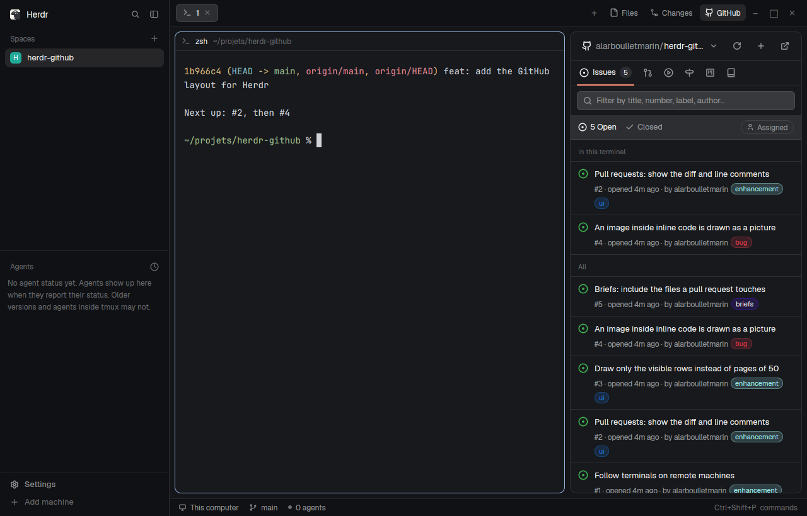

# GitHub for Herdr

A [Herdr](https://herdr.dev) layout: Herdr's `main` layout with a GitHub panel beside Files, and a Changes panel that does git the way Zed does. It follows the focused terminal's repository (or shows every repository you own) and covers issues, pull requests, CI runs, milestones, projects and the repository itself. Each issue, pull request or failed run becomes a brief for a coding agent: copy it, or start an agent on it in a new tab.

- **Issues and pull requests** with their states, labels, checks and reviews.
- **A github.com-style view**: the conversation with pictures and events, comment, close or reopen, labels, assignees, the merge box.
- **CI**: runs, jobs and steps, the trimmed failure log, re-run.
- **Agent briefs** that make the agent read the repository's own conventions first, stop on a plan for large work, and never push or comment without you.
- **Where work stands**: To do, In progress (brief copied, agent working or waiting), In review (a linked pull request), Done, on each row and in a board with four columns.
- **Changes, the Zed way**: a tree of changes with staging per file, folder or hunk, commit, amend, uncommit, push, pull, stash, branches, and the commit graph.
- **Empty states** for everything: gh missing or signed out, no repository here, nothing open, a missing token scope.

## Add it

Paste this into your agent, in Herdr:

> Add the Herdr layout from https://github.com/alarboulletmarin/herdr-github

It needs the [GitHub CLI](https://cli.github.com) signed in (`gh auth login`). `RECIPE.md` describes the layout in full, to build it again from scratch.

Inspired by Jankees van Woezik's [herdr-issues](https://github.com/jankeesvw/herdr-issues). Icons from [Lucide](https://lucide.dev) (ISC).
