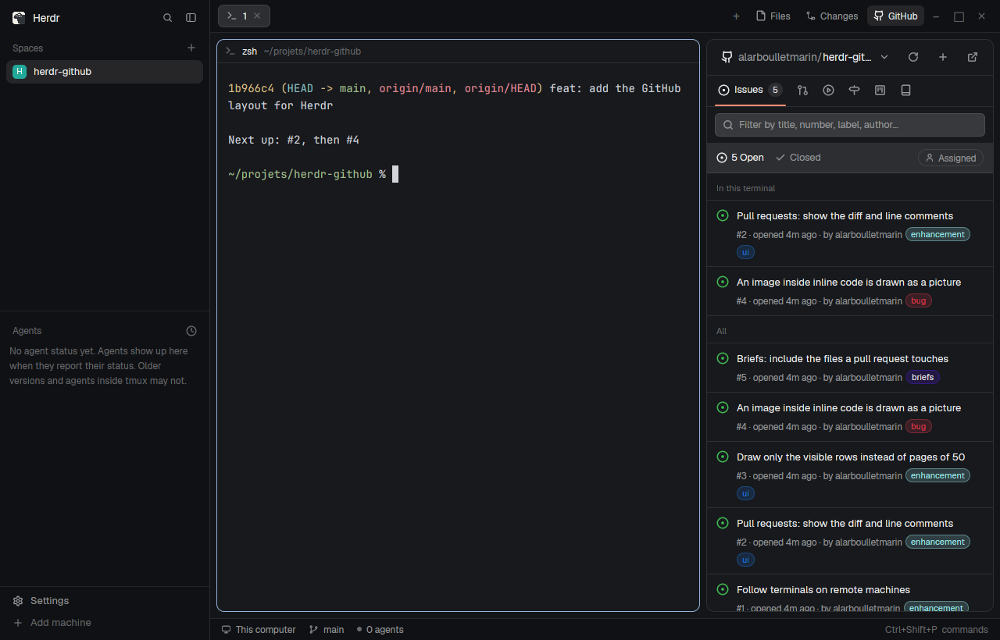

# GitHub

Herdr's `main` layout with a git Changes panel and a GitHub panel beside Files: the issues, pull requests, CI runs, milestones, projects and overview of the repository the focused terminal is in, or of every repository you own. Issues, pull requests and failed runs open in a github.com-style dialog, and each one turns into a brief for a coding agent: copy it, or start an agent on it in a new tab with one click.

## What you see

- **The GitHub button**, at the right end of the tab bar after Files and Changes: a 26px pill (6px radius, 12px text) with the GitHub mark and "GitHub", `selected` while its panel shows, `chrome` otherwise, exactly like the bar's own panel buttons.
- **The panel**, the third child of the side panel stack (368px by default, 280 to 900): a card with a 10px radius, a 1px `border` and the `background` color. GitHub's own state colors (Primer: open `#3fb950`, done `#a371f7`, closed `#f85149`, neutral `#9198a1`, attention `#d29922`, links `#4493f8`, the active tab underline `#fd8c73`; the light set when the theme's background is light) sit on Herdr's theme colors for everything else.
  - **A 46px header**: the repository switcher (a GitHub mark, `owner/` muted and the name semibold, a chevron; "pinned" in 10.5px `dim` when chosen by hand; "All repositories" with a stacked-books icon in that mode; "No repository" when there is none), then Refresh (a spinner while loading), Brief templates, New issue (+) and Open on GitHub.
  - **A 40px underline nav**: one 15px icon per tab, the selected one also says its name, with a counter pill (open issues and pull requests, "200+" past 200) and a 2px `#fd8c73` underline. Repository mode has Issues, PRs, Actions, Milestones, Projects and Repo; "All repositories" has Issues, PRs, Repos and Projects.
  - **A filter field** (30px, a search icon, "Filter by title, number, label, author…", its border turns the link color while typing).
  - **A 38px list header** on `raised`: the states with their counts (Open / Closed; Open / Merged / Closed for pull requests; All runs / Failing for Actions), then on the right an "Assigned" (issues) or "Mine" (pull requests) toggle, a milestone chip when filtering by one, and for Actions a "This branch" toggle showing the local checkout's branch.
  - **Rows** with a 1px `border` under each: the 16px state icon in its Primer color, the title (13px semibold, wrapping), a muted line (`#104 · repo · opened 1h ago · by login`), up to four label chips tinted with the label's color, and on the right the checks state, the review verdict, the comment count and the assignees. Pull requests show their branch; runs show workflow, `#number`, the branch as a blue monospace pill and the event.
  - **Milestones** as progress bars (8px, green fill, "60% · 3 open · 2 closed · Due Nov 12", red "Past due"); **projects** with owner, number and item count; **repositories** with language, stars, open issues and pull requests, last push and "cloned" when there is a local checkout.
  - **The Repo tab**: name, Public/Private and Archived badges, description, homepage, topics, stars, forks, watchers, license, "Open on GitHub" and "Copy clone URL"; **This machine** (folder, branch, uncommitted count, ↑ahead ↓behind, "Terminal here", or "Clone with gh"); **At a glance** (open issues, open pull requests, branches and the default one, workflow runs); the last five **releases** with Latest and Pre-release badges.
  - **Empty states** in GitHub's Blankslate style (a 40px round icon, a 14px title, a 12px line, buttons): gh missing ("Install gh"), signed out (`gh auth login` with "Run in a new tab" and "Check again"), no repository here ("Choose a repository", "All repositories"), loading skeletons, load errors with Retry, the Projects permission (`gh auth refresh -s read:project` with Copy and Run), no filter match ("Clear filter"), and per tab ("No open issues", "No failing runs"…).
- **The issue and pull request dialog**, 88% by 92% of the window: a toolbar (Back after following a link, `owner/repo #N`, the last error in red, Refresh, Copy, Open on GitHub, Checkout for an open pull request, a pencil that opens the brief templates previewed on this item, Copy brief (Review / Fix for pull requests), Review and a green Fix for pull requests or a green Start agent for issues, close), the title at 28px, a 32px state pill (white on the state color) with who opened it, or for a pull request "login wants to merge into `base` from `head` +12 −3 · 4 files". Left, the conversation: the opening post and each comment or review as a card (a 38px `raised` header with a 20px avatar, the login, bot / Author / Owner / Member badges, the time; markdown below with its pictures; reactions as pills), and the events between them on a 2px rail (a 28px round icon, filled for closed, reopened and merged: labels added or removed, assignments, renames, milestones, mentions from other issues, commits). Then, for an open pull request, a merge box (checks, review decision, conflicts), and "Add a comment" with Write / Preview, Close (and "Close as not planned" for issues) or Reopen, and a green Comment. Right, a 268px column: Reviewers, Checks, Assignees ("Assign yourself"), Labels (Edit shows every label of the repository as chips to flip), Milestone, Development, This machine and Participants.
- **The run dialog**, 80% by 88%: the workflow, the run's title at 24px, its state, number, attempt, branch, commit, event and duration; each job as a collapsible card (failing ones open) with its steps, the failing step tinted red; then "Failure log", the lines around the errors in monospace. Buttons: Re-run failed jobs (or Re-run), the brief templates pencil, Copy brief and a green "Fix with agent".
- **Popups**: the repository switcher (340px: "Switch repository", a search field, "Follow the terminal" with the terminal's repository below, "All repositories", then every repository you and your organizations own, most recently pushed first), the copy menu (300px: Copy link, Copy reference `owner/repo#N`, Copy number and title, each with the text it copies), the agent menu (300 by 340: "Start an agent on #N repo", the installed agents with their icons, the last one started first, "In a new worktree" ticked when there is a local clone, and the folder and branch it will run in).
- **The brief templates dialog**, 90% by 90%: "Brief templates" and "What Copy brief and the agents receive. Saved as you type."; a 220px list (Briefs: Issue, Pull request · Review, Pull request · Fix, CI run; Shared blocks: Conventions, Rules, Report), an "edited" mark in the attention color on the ones you changed; the template in a Markdown editor with line numbers, Reset to default above it, and below its variables as monospace chips (click copies `{{name}}`, hover says what it holds) with a red "Unknown: {{…}}" line for a name that doesn't exist; on the right the brief it makes, in monospace, on the item the dialog was opened from (an example issue, pull request or run otherwise), with a copy button.
- **A new-issue dialog** (640 by 480, modal): Title, Description (Markdown), Cancel and a green Create issue.

## How it behaves

- **Following the terminal.** The panel shows the repository of the focused terminal's folder (its `origin` remote on github.com). A terminal outside any repository shows "No repository"; focusing the Files panel or another non-terminal pane keeps the last terminal's. Spaces on another machine aren't followed: pick the repository by hand. The switcher can pin a repository or "All repositories" per space; "Follow the terminal" unpins.
- **All repositories** covers your login and every organization you belong to (`gh api user/orgs`), through `gh search`.
- **Loading.** Each tab and filter is fetched on first show and cached (`localStorage`), so it shows at once next time. Every 60 seconds the shown tab refreshes; while a run is in progress the Actions tab refreshes every 10 seconds. A hidden panel doesn't fetch, scan or redraw. Up to 200 issues, 100 pull requests, 50 runs, 50 projects per owner and 100 repositories per owner.
- **Paging.** Lists draw 50 rows, then "Show 50 more · N left" (drawing 200 rows in one frame is too slow); changing tab, filter or search goes back to 50.
- **Hover.** A hovered row shows Copy agent brief and Start an agent in a small framed box over its top-right corner, over the text, so nothing moves; pull requests offer Review and Fix, with both briefs in Copy brief; a failed run shows Re-run failed jobs there. Right-click a row for the copy menu at the pointer; right-click a milestone or repository to open it on GitHub.
- **Clicks.** A row opens its dialog; a milestone filters Issues by it; a repository pins it; a project opens on GitHub. In the dialog, `#123` and `owner/repo#123` outside code are links: issues and pull requests open in the dialog with Back, other links in the browser.
- **Menus** open under the button that opened them, right edges aligned, even when they appear after a network round trip (the agent menu waits for the full issue to build its brief).
- **Acting on GitHub.** Comment (also Ctrl+Enter), Close as completed or not planned, Reopen (each takes the box's text along as a comment), Assign yourself or Unassign me, and flipping labels run `gh issue|pr …` at once, then reload the dialog and tell the panel (shared `github.changed`) to refresh. Nothing is sent without a click.
- **Briefs.** "Copy brief" writes a Markdown brief to the clipboard; "Start agent" opens the agent menu and launches the picked agent in a new tab, in the space of the local clone when there is one (else the active space), with the brief as its first message. With "In a new worktree" (the default when there is a clone) the agent gets its own worktree at `~/.herdr/worktrees/<repo>/<owner>-<issue|pr>-<N>` (one folder per item, so two forks' branches or two owners' #7 never share one; a folder deleted by hand is pruned and made again), on `fix/N-title` for an issue labelled bug, `feat/N-title` otherwise, created from `origin/HEAD` (the clone's branch when offline), reused when it already exists; a pull request is checked out there with `gh pr checkout -R owner/repo` (as `pr-N` when its branch is busy elsewhere; if both fail the worktree is removed again). The clone and its uncommitted work are left alone, and the brief starts with a "Workspace (already prepared)" note so the agent neither branches again nor leaves. A brief has the context (link, local clone and branch with its uncommitted count, labels, milestone, assignees), the issue or pull request text and its last comments or reviews inside `<issue>`, `<comment>` and `<review>` tags declared as data, then: read the repository's conventions first (AGENTS.md, CLAUDE.md, CONTRIBUTING.md, `git log`, the workflows), which outrank the brief; size the task and stop on a short plan if it's large; acceptance criteria; a branch; reproduce, change, verify; rules (no push, comment, close, merge or release without approval, a `git worktree` when the tree is dirty, no new dependency, Conventional Commits only when the repository has no format of its own, code and commits in the repository's language); and a report in French. A run's brief carries its failing jobs and steps and the trimmed failure log inside `<log>`. Briefs are written in English. Every brief is a template you can change in the brief templates dialog (`briefs.js`; saved in shared `github.briefs`, only the templates that differ from the default: `localStorage` belongs to one mod copy, and the dialog, the panel and the issue and run dialogs are separate copies): `{{variable}}` takes the item's value, `{{conventions}}`, `{{rules}}` and `{{report}}` the shared blocks, a line holding only an empty variable disappears, an unknown name stays as written, and GitHub text is inserted once, never read as a variable. The agent menu remembers the last agent started and whether "In a new worktree" was ticked (shared `github.agent`).
- **Pull request briefs.** Review starts an agent for a read-only review against the repository's conventions and the linked issue, using a separate worktree or `gh pr diff`: numbered findings in French (file:line, problem, severity, suggested fix), no edits, commits, pushes or GitHub posts. Fix starts an agent on the PR's branch to reproduce failing checks and address requested changes, verify and commit locally. Copy brief opens the existing copy menu with both briefs. Issues keep their single brief.
- **Where work stands** (`work.js`, shared `github.work`): an open issue or pull request is To do, In progress, In review or Done. Starting an agent on it marks it In progress (copying its brief does not, and old brief marks are ignored); the agent started from the panel is found again by the folder it works in (its worktree, on the machine it started on, whichever space its tab is now in), or by its tab name when it runs in the clone, so the row says "Agent working" (spinner) or "Agent needs you", and once the agent has finished, "Agent finished" in In review: its work is yours to check. Wherever an agent is shown (the row's hover box, the board card, the dialog's Status) Join focuses its tab (`agent.focus`); when it says "Agent finished" and its mark has a worktree folder, Changes beside Join opens the git History dialog on that local worktree (only the commits added since the ref the worktree started from, recorded in its mark as `base` (`origin/HEAD`, or the clone's branch when there is none; `origin/HEAD` for older marks), with their patches; "Whole branch" shows the rest, and a base that no longer resolves falls back to it); an issue with a linked pull request is In review; closed or merged is Done. The dialog's sidebar starts with Status: To do / In progress / In review set it by hand (an agent never overrides that), Auto clears it. Rows show In progress and In review as a small pill.
- **The board** (the header's board button, or `github.board`): a dialog, 94% by 90%, with four columns, To do, In progress, In review and Done, each a `raised` card with a colored dot, its name and count. The open issues and pull requests and the last 20 closed issues, each in its stage (`work.js` `columns`: a pull request that closes an issue on the board is that issue's card), newest first, 30 per column then "Show more". A card has its state icon, number (and branch for a pull request), the title, three labels, why it is in its stage, the assignees and when it last changed. Click opens the issue dialog; right-click or its chevron opens "Move to…" (To do, In progress, In review, then Auto). It refreshes every 60 seconds and after any action in a dialog.
- **Keys**: `herdr-app do github.<command>` (or a binding in `keys.json`, e.g. `"alt-g i": "github.issues"`): `issues`, `prs`, `actions`, `milestones`, `projects`, `repo`, `repos` pick a tab; `refresh`; `board` opens the board; `open` opens the first row; `switch` opens the repository switcher; `all` and `follow` set the space's mode. `briefs` opens the brief templates dialog.
- **Local clones.** The panel finds clones under the usual project folders of your home (`projets`, `projects`, `Projects`, `code`, `Code`, `src`, `dev`, `Developer`, `work`, `git`, `github`, `Documents/GitHub`, `.herdr/worktrees`, three levels deep), plus any `roots` given in the block's props, plus the spaces' own folders. A clone gives the dialogs their "This machine" section, the agent its folder and the Actions tab its "This branch" filter.

## Built from

- **Layout** `layouts/github.json`: Herdr's `main` 0.1.10. The `tabs` block's mod is `tabs-github`; the side panel's `panel-body` stack has its `changes` block's mod set to `git` (see The Changes panel) and gets a third child `{ "id": "github", "type": "block", "content": { "mod": "github" } }`. Its props can take `roots` (more folders holding clones, relative to home or absolute) and `repo` (`owner/name`: a copy fixed on one repository, e.g. in a pane).
- **Mod** `mods/tabs-github/`: Herdr's `tabs` 0.1.10 with a third panel button, `panelButton("github", "GitHub", "mods/github/icons/github.svg")`, and `github` always among the enabled panels.
- **Mod** `mods/github/` (`mod.json`: `place: "none"`; the layout places it). One default export, `GitHub`, whose `init` dispatches on `props()`: `item` (the issue or pull request dialog, `viewer.js`), `run` (the run dialog, `run.js`), `agentMenu`, `copyMenu`, `picker` (popups), `create` (the new-issue dialog), `briefs` (the brief templates dialog, `briefs.js`); otherwise it's the panel (`main.js`). `gh.js` wraps the CLI and holds a loader per tab; `brief.js` writes the briefs from their templates; `log.js` trims failure logs; `timeline.js` turns the REST timeline into cards and events; `media.js` splits markdown around its pictures and fetches pictures and avatars; `ui.js` has Primer colors, icons and the shared pieces (button, counter, segmented control, blankslate, skeleton, label chip); `actions.js` the clipboard, agent and copy menus. Its icons in `icons/` are Lucide's (ISC, `icons/LICENSE`) and a few drawn in their style (the GitHub mark, the issue and pull request states).
- **herdr**: `spaces`, `panes`, `focused`, `layout`, `theme`, `agents`, `exec`, `run` (`layout.select`, `layout.show`, `layout.hide`, `tab.new` with `argv` and `task`, `terminal.open`), `openOverlay` (dialog, popup with `at`), `closeOverlay`, `notify`, `props`, `shared` / `setShared` (`github.tab`, `github.pick`, `github.changed`, `github.briefs`, `github.agent`, `workspace.panels`), `nextCommand`, `knownAgents`, `appHome`, `home`, `localStorage`, `fs/promises`.
- **gpui-base**: `InputState` / `Input`, `TextareaState` / `Textarea`, `EditorState` / `Editor` (Markdown, for the brief templates), `TextView.markdown` with `on_link_click`.
- **Programs**: `gh` (`api`, `issue`, `pr`, `run`, `search`, `repo`, `release`, `project`, `label`), `git` (`remote get-url origin`, `status --porcelain=v2 --branch`), `curl` (avatars and pictures), `file` (picture sizes), `find` and `bash` (looking for clones).

## The Changes panel (git)

The layout's Changes panel is the `git` mod, in the spirit of Zed's git panel: the changes of the focused terminal's repository as a tree, staging per file, folder or hunk, commit, amend, uncommit, sync, stash, branches and the commit graph. It sits in the side panel's `changes` slot, so the tab bar's Changes button opens it.

### What you see

- **The panel**, in the side panel's `changes` slot (the tab bar's Changes button opens it; 368px by default): a card with a 10px radius, a 1px `border`, the `background` color. File letters use the theme's terminal colors: A `ansi2`, D and U `ansi1`, R `ansi4`, M `blocked`.
  - **A 42px header**: the branch (branch icon, name or "detached abc1234", a chevron, ↑ahead ↓behind) opening the branch picker; a spinner while reading; History; the sync button (Publish, Pull ↓n, Push ↑n or Fetch, whichever is due); ⋯.
  - **A 34px bar**: "N changed · M staged", Tree/List, Review every change, Stage all / Unstage all.
  - **The list**: sections Conflicts, Tracked, Untracked, each with a checkbox and a count. Tree mode puts folders first, folds a folder with a single folder inside into one row (`src/app`), and folds any folder on a click. A row: chevron or indent, the staging checkbox (on, off, or a dash when partly staged), the letter, the name, "← old name" for a rename, +added −removed. At most 400 rows are drawn. A clean tree says "Working tree clean".
  - **The commit box**: a Markdown-free message (2 to 8 lines), a compact options row with Amend (fills in the last message when empty), Sign off and Skip hooks, then the busy state ("Pushing…"), Preview (the next commit), and the primary button: "Commit N" for N staged files, "Commit tracked" when nothing is staged (`git commit -a`), "Amend".
  - **The last commit**: short hash, subject, when, and Uncommit (`git reset --soft HEAD~1`, its message back in the box), disabled once that commit is on the upstream.
- **The review dialog**, 90% by 90%: changed files on the left (checkbox, letter, name, folder), the picked file on the right: its path (old → new for a rename), +/−, Stage file / Unstage file, Discard… (Delete… for a new file), then a virtual list of rows: "Unstaged · N hunks", each hunk's header with a "Stage hunk" chip, its lines with old and new numbers on red and green, then "Staged · N hunks" with "Unstage hunk". A new file shows its text as added lines.
- **The next-commit dialog**, 90% by 90%: the current commit message, read-only, above the files and their +/− counts on the left and a virtualized diff on the right. Staged changes take precedence; otherwise "Commit tracked: N files, untracked files not included" previews tracked changes against HEAD. Amend shows only staged changes. Refresh reloads the preview; Commit (or Amend) asks the panel to commit with this message, amend choice, signoff and hook bypass.
- **The history dialog**, 92% by 90%: `git log --graph --date-order` (400 commits), each graph column colored by its lane (two columns per lane, the theme's ansi colors), the commit's dot as ●, its refs as chips (◉ for HEAD, tags), subject, author, when, short hash; This branch / All branches. Right, 40%: the message, author, date, the hash (click copies the full one) and `git show --stat --patch`.
- **Popups**: the branch picker (360px wide, height follows the content with a list capped at 330px: an aligned field and rows, "Create branch “name”" when the name is new and valid, the current branch first and checked, then local branches by last commit and remote-only `origin/*` branches in a muted Remote section), ⋯ (Fetch, Fetch from…, Fetch all with several remotes, Pull, Pull (rebase), Push, Push to…, Force push…; Review changes and History and graph; Stash all changes, Pop the latest stash, the last six stashes, each opening Apply / Pop / Drop…; an entry that cannot run is greyed with the reason as its tooltip: no remote, no upstream, detached HEAD, a command running), the remote picker for Fetch from… and Push to… (380px, one remote per row with its URL, skipped with a single remote), a file's right-click menu (Open diff, Copy path, Discard changes… or Delete this new file…), and a modal confirm (420 by 190) before Discard, Delete, Drop and Force push (`--force-with-lease`, refused by git if the remote moved since the last fetch), its button in `ansi1`.

### How it behaves

- **Following the terminal**: the focused terminal's folder and machine, as Herdr's Changes panel finds them. Reads use `--no-optional-locks` and no index refresh, so they write nothing under `.git`; a folder watch (this machine only) refreshes on every change, `.git/index` included, plus every 10 seconds.
- **One command at a time**: staging, committing, syncing and stashing run in the panel, then it reads the status again; a failure shows in red and as an error toast whose body is the line of git's error that says why (`! [rejected] …`, `error:`, `fatal:`, not push's leading `To <url>`). Herdr's `exec` stops a command after 30 s and rejects ("git took longer than 30 s and was stopped"), so the panel never stays busy longer; a fetch, push or hook that needs more fails there and belongs in a terminal. Popups and dialogs ask through shared `git.do` (`{ at, root, action, arg }`), which the panel of that repository acts on once, so the work outlives the popup; the panel claims it after the render that saw it, since a task started in render runs inside it, where `notify` throws.
- **Next commit** uses the same commit path as the panel, with fresh status before committing. The message, amend choice, signoff and hook bypass are captured when Preview opens; later edits in the panel do not change that snapshot. New untracked files are excluded; an initial commit can preview staged additions without HEAD.
- **Commit options**: Sign off (`--signoff`) is remembered per repository and machine. Skip hooks (`--no-verify`) resets after a successful commit and on repository changes. The panel button, Ctrl+Enter and Next commit use the same options.
- **Switching branches**: remote-only origin branches create a local tracking branch when picked. A switch blocked by local edits offers Carry changes (`--merge`, which may leave conflicts) or Stash and switch (including untracked files, kept in the stash without an automatic pop). Up/Down selects a row and scrolls it into view; Enter picks it and Escape closes the picker.
- **Hunks** go through `git apply --cached` (`-R` to unstage), the patch passed as an argument to `sh` (`exec` has no stdin), so it works on another machine too.
- **Discard** puts a tracked file back to HEAD (index and tree, both names of a rename), removes an added one, deletes an untracked one, always after the confirm.
- **Keys**: `herdr-app do git.<command>`: `refresh`, `history`, `diff`, `commit`.

### Built from

- **Mod** `mods/git/` (`place: "none"`): `main.js` (the panel; its `init` dispatches on `props()`: `diff`, `nextCommit`, `history`, `menu`, `branches`, `confirm`), `diff.js`, `next-commit.js` (read-only next commit), `history.js`, `git.js` (a `Repo` per root and machine: status, stage, unstage, applyHunk, discard, diff, nextCommit, commit, log, show, branches, remotes, sync, switchBranch), `parse.js` (pure: porcelain v2 status, numstat, diffs and hunks, patches, the log graph, the tree, the sync action, an error's gist; `parse.test.mjs` checks them against a real repository), `ui.js` (icons, buttons, the checkbox, `ask` and `confirm`). Icons: Lucide's (ISC).
- **herdr**: `spaces`, `panes`, `focused`, `exec`, `readTextFile`, `watchFolder`, `theme`, `props`, `shared` / `setShared`, `openOverlay`, `closeOverlay`, `notify`, `nextCommand`, `localStorage`.
- **gpui-base**: `TextareaState` / `Textarea`, `InputState` / `Input`, `v_virtual_list` with `on_item_click` (rows drawn inside a virtual list take no handlers: the branch picker picks by key), `Scrollbar`.
- **Programs**: `git`, `sh`.

### Done when

- `herdr-app check mods/git` passes and `node mods/git/parse.test.mjs` and `node mods/git/git.test.mjs` pass.
- With a terminal in a repository with staged, unstaged, partly staged, renamed, deleted and untracked files, the panel lists them in their sections with the right checkboxes; ticking one stages it, ticking a folder stages everything under it.
- Preview a partly staged file: only its index version appears. With nothing staged, tracked edits and deletions appear but untracked files do not. Commit from the preview uses its message; Amend without staged changes keeps the tree.
- In the review, clicking "Stage hunk" on one of two hunks stages that one only.
- A commit, an amend, an uncommit, a push of a new branch (Publish) and a stash and pop work from the panel.
- History shows a merge with its two lanes in two colors.
- The branch picker lists the branches (current first, a Remote section), and switching with a conflicting local edit offers Carry changes (lands with the conflict shown) or Stash and switch (lands clean, the edit in the stash).
- A failing `pre-commit` hook stops a commit with its message as the toast; with Skip hooks and Sign off it commits with a `Signed-off-by:` line.
- Force push is refused while the remote moved since the last fetch (toast `! [rejected] … (stale info)`) and goes through after a fetch.
- Fetch from a remote that never answers shows "Fetching…", then after 30 s lets go with an error toast.

## Watch out

- A popup is as tall as its content: a list that is `flex_1` inside one collapses to nothing. Give it a fixed height (the switcher's list is 372px).
- A dialog's mod is a fresh copy: pass what it needs through `props` (JSON only), and read them with `props()`, not `init`'s first argument.
- `cx.notify()` from a render's `cx` kept for later does nothing; redraw from `cx.spawn(async (cx) => …)`.
- A popup opens at the pointer by default; after a network round trip the pointer has moved. Remember the pressed button's bounds (`on_mouse_down` gives them) and pass `at`.
- Every row reading `spaces()`, `panes()` and `focused()` crosses into the app each time; read them once per render. With 100+ rows and a full redraw on every hover, the frame ran out of time ("the view could not be re-rendered … interrupted").
- Hover controls that replace a row's right column change its width and make long titles re-wrap: draw them over the row (`absolute`) instead.
- `currentColor` isn't a color, and there's no `line_clamp`.
- Herdr's markdown view draws no images: pictures are cut out of the markdown and drawn between its runs at their own width, never wider than the column. A picture's size comes from `file`; without `file` it shows "Couldn't show this image · open it". github.com attachments of private repositories are fetched with the `gh` token, sent only to github.com.
- `herdr-app do github.<command>` reaches every copy of the mod: with the panel and a pane copy open, `open` opens two dialogs.
- Projects need the `read:project` scope, which `gh auth login` doesn't grant; the panel says so and offers the command.
- Search results ("All repositories") carry no bodies, so their dialogs and briefs fetch the issue first.
- The window only redraws while it's visible: `herdr-app shot` of a hidden window shows the last frame.

## Done when

- `herdr-app check mods/github`, `herdr-app check mods/git` and `herdr-app check mods/tabs-github` pass, and `node mods/github/<name>.test.mjs` passes for `brief`, `log`, `media` and `timeline`.
- With `gh` signed in and a terminal in a clone, the GitHub button opens the panel on that repository's open issues, with the count on the tab; a terminal outside any repository shows "No repository here" and "Choose a repository" opens the switcher with your repositories listed.
- Hovering a row with a long title doesn't move it; a list of 120 issues scrolls to its end and "Show 50 more" adds rows.
- Opening an issue shows its body with its pictures, its comments and events, and the sidebar; Copy brief puts a brief starting with `# Resolve issue owner/repo#N` on the clipboard; Start agent opens the agent menu under the button and starts the agent in a new tab with the brief. The pencil opens the brief templates on that issue; editing the Issue template changes the preview at once, marks it edited, and the next Copy brief; Reset to default brings the original back.
- A finished agent with a worktree has Changes beside Join in the row’s hover box, board card and dialog Status; it opens git History in that worktree, limited to `<base>..HEAD`. Working or blocked agents and marks without a folder have no Changes button.
- Once the item is closed or merged and no agent is left in its worktree, Clean up (row, board card, dialog Status) runs `git worktree remove` (refused with uncommitted changes), deletes the branch only if `origin/HEAD` holds it after a fetch (a squash-merged or unmerged branch is kept, and the toast says so), then forgets the mark.
- A failed run opens with its failing job unfolded and the failure log; Fix with agent starts an agent with its brief.
